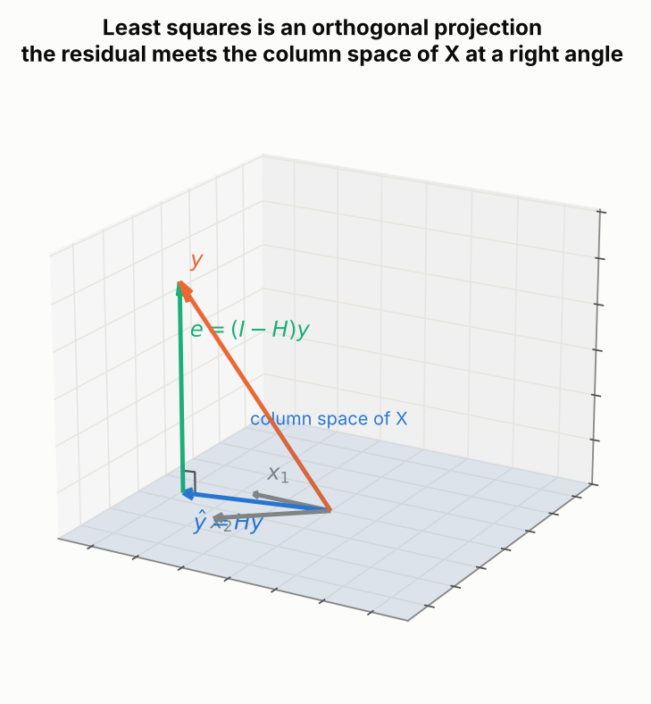
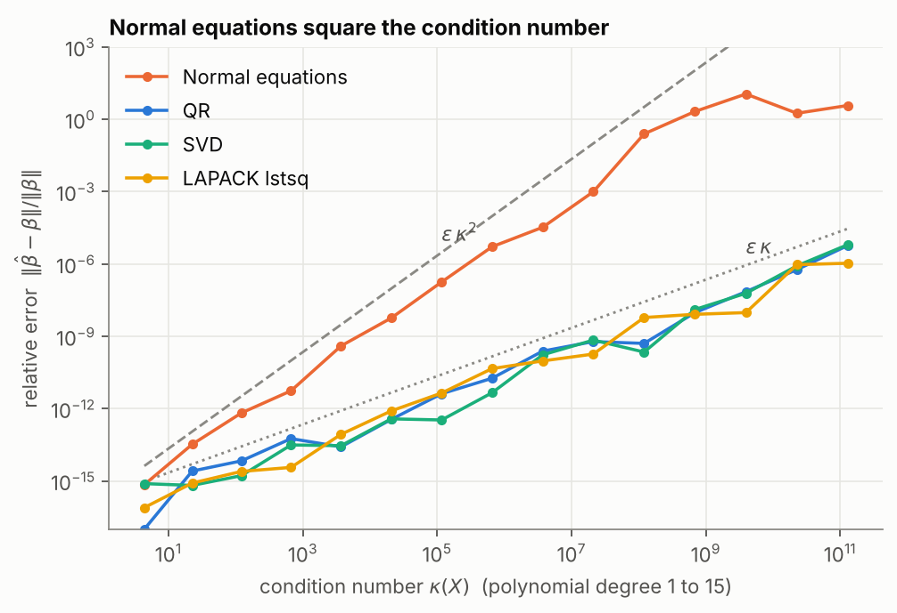
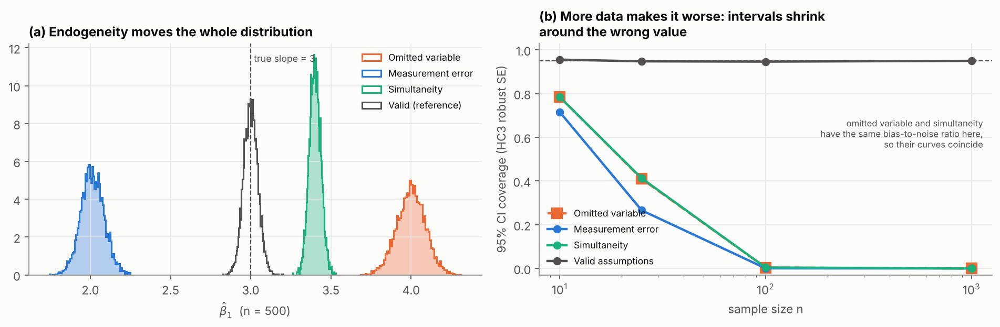
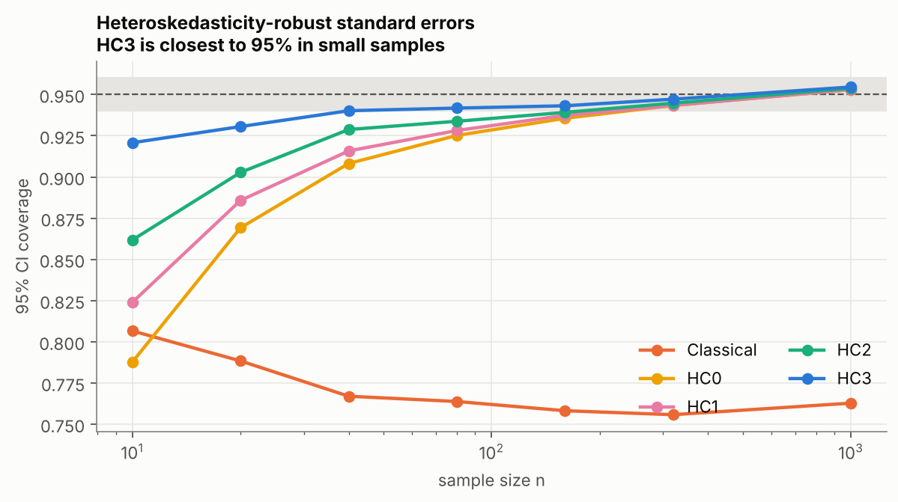
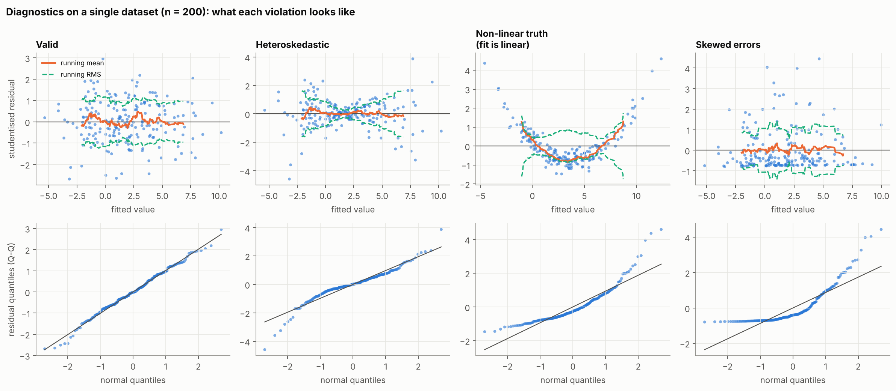

# When Regression Lies

**A Monte Carlo study of ordinary least squares, statistical inference, and model assumptions.**

OLS is usually taught as a formula. This project treats it as a claim that can be tested: if we know the true data-generating process, we can simulate it thousands of times, fit OLS every time, and check whether the estimates, standard errors, confidence intervals and p-values behave the way theory says they should. Then we break one assumption at a time and measure exactly what goes wrong.

The central question:

> *Under what conditions does OLS produce misleading estimates, confidence intervals, and statistical conclusions?*

Everything is implemented from scratch in NumPy (QR, normal equations, SVD, hat matrix, classical and robust covariance estimators, t and F tests, leverage, Cook's distance) and verified against `statsmodels` to 10 significant digits.

---

## Key findings

The true model throughout is $Y = 2 + 3X + \varepsilon$. Each row below is 5,000 simulated datasets of size $n = 100$.

| Scenario | Breaks | Bias | Classical SE / true sd | Coverage: classical | HC3 | HAC | False positives (classical) |
|---|---|---:|---:|---:|---:|---:|---:|
| Valid assumptions | none | +0.000 | 0.99 | 95.0% | 94.6% | 92.8% | 5.6% |
| Omitted variable | A3 exogeneity | +0.998 | 1.00 | 0.3% | 0.4% | 0.3% | 99.8% |
| Measurement error | A3 exogeneity | -0.988 | 0.99 | 0.0% | 0.0% | 0.0% | 5.3% |
| Simultaneity | A3 exogeneity | +0.402 | 0.98 | 0.4% | 0.4% | 0.3% | 99.7% |
| Heteroskedastic | A4 homoskedasticity | -0.001 | 0.59 | 75.9% | 94.4% | 91.9% | 25.2% |
| Autocorrelated | A4 no autocorrelation | +0.002 | 0.48 | 66.0% | 65.3% | 81.1% | 34.5% |
| Skewed errors | A5 normality | -0.001 | 0.94 | 95.1% | 92.5% | 87.5% | 4.3% |
| Heavy-tailed errors | A5 normality | +0.001 | 0.94 | 95.0% | 95.8% | 90.3% | 4.9% |

*"False positives" is the share of samples where a t-test finds a significant slope when the true slope is 0.*


What the numbers say:

1. **There are two very different ways to be wrong.** Endogeneity breaks the *estimate*: the slope converges to the wrong number. Heteroskedasticity and autocorrelation leave the estimate unbiased but break the *standard error*. The fixes are completely different, and confusing the two is the most common mistake.
2. **Unbiased does not mean trustworthy.** Under heteroskedasticity the slope is right on average (bias −0.001), yet the classical SE is 41% too small and a true null is rejected 25% of the time instead of 5%.
3. **With endogeneity, more data makes things worse.** The bias stays fixed while the intervals shrink around the wrong value. Coverage goes from 74% at $n = 10$ to 0.3% at $n = 100$ and 0% at $n = 1000$. Notice that the classical SE is perfectly honest about the *noise* (ratio 1.00); it simply measures precision around the wrong target.
4. **Robust SEs fix only what they are designed for.** HC3 restores 95% coverage under heteroskedasticity but does nothing for autocorrelation (65%). Newey-West helps (81%) but still under-covers with persistent data, and both robust estimators pay a price in small samples when nothing is wrong.
5. **Normality matters least.** With skewed or heavy-tailed errors, classical inference is already close to 95% at $n = 10$. Unbiasedness and Gauss-Markov never needed normality; the CLT handles the rest.
6. **Numerics matter too.** Solving the normal equations squares the condition number. On an ill-conditioned design, QR recovers the coefficients to $10^{-9}$ while the normal equations are off by 25%.

---

## Repository structure

```
when-regression-lies/
├── src/regression_lies/
│   ├── ols.py          # OLS from scratch: solvers, hat matrix, classical/HC0-HC3/HAC covariance, t/F tests, diagnostics
│   ├── dgp.py          # data-generating processes, each breaking exactly one assumption
│   ├── montecarlo.py   # vectorised simulation engine (fits 5,000 regressions in one call)
│   └── plotting.py     # shared figure style
├── experiments/
│   ├── e01_linear_algebra.py     # projection geometry, solver accuracy, multicollinearity
│   ├── e02_baseline.py           # all assumptions hold: does theory match simulation?
│   ├── e03_violations.py         # break A3, A4, A5 one at a time
│   ├── e04_robust_inference.py   # HC0-HC3, WLS, Newey-West, robust Wald tests
│   ├── e05_diagnostics.py        # residual plots, Q-Q plots, leverage, Cook's distance
│   └── run_all.py
├── tests/test_ols.py   # every estimator checked against statsmodels + projection identities
├── docs/
│   ├── THEORY.md       # derivations behind every result, linked to the experiment that tests it
│   └── STUDY_GUIDE.md  # questions to test your understanding, with answers
└── results/
    ├── figures/        # all figures in this README
    └── tables/         # every number in this README, as CSV
```

## Reproduce

```bash
git clone https://github.com/stefsamaha/when-regression-lies.git
cd when-regression-lies
pip install -r requirements.txt

python -m pytest                    # 17 tests against statsmodels
python experiments/run_all.py       # all experiments, about 1 minute
python experiments/run_all.py --R 1000   # faster pass
```

All randomness uses fixed seeds, so every number in this README is reproduced exactly.

Using the library directly:

```python
import numpy as np
from regression_lies import OLS

rng = np.random.default_rng(0)
x = rng.standard_normal(200)
y = 2 + 3 * x + np.sqrt(0.1 + x**2) * rng.standard_normal(200)
X = np.column_stack([np.ones_like(x), x])

model = OLS(method="qr").fit(X, y)
print(model.summary(cov_type="classical", names=["const", "x"]))
print(model.summary(cov_type="HC3", names=["const", "x"]))
```

---

## The assumptions

| | Assumption | Needed for |
|---|---|---|
| A1 | Linearity: $y = X\beta + \varepsilon$ | everything |
| A2 | Full rank: $X'X$ invertible | a unique $\hat\beta$ |
| A3 | Exogeneity: $E[\varepsilon \mid X] = 0$ | unbiasedness and consistency |
| A4 | Spherical errors: $\text{Var}(\varepsilon \mid X) = \sigma^2 I$ | the classical SE formula, Gauss-Markov |
| A5 | Normality: $\varepsilon \mid X \sim N(0, \sigma^2 I)$ | *exact* t and F distributions in small samples |

Everything follows from one identity: $\hat\beta = \beta + (X'X)^{-1}X'\varepsilon$. A3 controls the mean of the second term, A4 its variance, A5 its distribution. Derivations are in [`docs/THEORY.md`](docs/THEORY.md).

---

## Experiment 1: the linear algebra of least squares

**Projection geometry.** The normal equations $X'(y - X\hat\beta) = 0$ say that the residual is orthogonal to every column of $X$. So $\hat y = Hy$ is the orthogonal projection of $y$ onto the column space of $X$. Rotating $\mathbb{R}^3$ with the full QR basis puts that column space flat on the floor, which makes the right angle visible. Numerically, $H = H'$, $H^2 = H$, $\text{tr}(H) = p$ and $X'e = 0$ all hold to about $10^{-16}$.



**Solver accuracy.** With polynomial regressors the condition number $\kappa(X)$ explodes. QR, SVD and LAPACK all lose accuracy like $\epsilon\,\kappa$; the normal equations lose it like $\epsilon\,\kappa^2$ because $\kappa(X'X) = \kappa(X)^2$. This is why every serious library solves least squares with QR or SVD.



**Multicollinearity** inflates variance by $\text{VIF} = 1/(1 - \rho^2)$, matching theory exactly, but leaves the estimator unbiased and coverage at 95%. It is not a violation. It is the data honestly reporting that it cannot separate two effects.


## Experiment 2: when everything holds

The slope is unbiased at every sample size, and its spread matches the exact theoretical value $\text{sd}(\hat\beta_1) = 1/\sqrt{n-3}$ (e.g. 0.1454 simulated versus 0.1459 predicted at $n = 50$).

| n | mean $\hat\beta_1$ | empirical sd | theory sd | coverage (t crit.) | coverage (1.96) |
|---:|---:|---:|---:|---:|---:|
| 5 | 3.006 | 0.723 | 0.707 | 95.7% | 85.9% |
| 10 | 3.002 | 0.372 | 0.378 | 94.6% | 91.1% |
| 50 | 3.002 | 0.145 | 0.146 | 94.9% | 94.4% |
| 1000 | 3.000 | 0.031 | 0.032 | 95.4% | 95.4% |

The t-statistic follows Student $t_{n-2}$ exactly. Using the normal critical value 1.96 at $n = 5$ gives 86% coverage instead of 95%: the extra width of the t distribution is the price of estimating $\sigma$. Under a true null the p-values are uniform and a test rejects 5% of the time, as does the F-test of a joint hypothesis (4.9%). The Gauss-Markov theorem also shows up: a competing linear unbiased estimator has sd 0.207 versus 0.165 for OLS.


## Experiment 3: breaking the assumptions

**Endogeneity (A3).** Each mechanism shifts the distribution of $\hat\beta_1$ by exactly the amount the bias formula predicts: $+1.000$ for the omitted variable, $-0.987$ for measurement error (attenuation), $+0.400$ for simultaneity. Since the bias does not shrink but the SE does, the t-statistic for the true value diverges, and coverage collapses as $n$ grows.



One subtle result: measurement error does not create false positives. If the true slope is zero, attenuating it still gives zero. Omitted variables and simultaneity, by contrast, "discover" an effect that does not exist almost 100% of the time at $n = 100$.

**Non-spherical errors (A4).** Under heteroskedasticity and autocorrelation the slope stays unbiased, but significance becomes unreliable. With autocorrelation, the classical false-positive rate *increases* with sample size, from 18% at $n = 10$ to 37% at $n = 1000$.


**Non-normal errors (A5).** Inference is nearly exact even at small $n$. The extreme case is Cauchy errors (no finite variance): the slope barely concentrates (its interquartile range only halves from $n = 10$ to $n = 1000$) yet coverage is about 95%, because the t-statistic is self-normalising. Correct coverage does not imply useful precision.

## Experiment 4: repairing inference

**Heteroskedasticity-robust SEs.** All HC estimators are consistent, but HC0 under-covers in small samples because residuals at high-leverage points are shrunk ($\text{Var}(e_i) = \sigma^2(1-h_{ii})$). HC2 and HC3 inflate those residuals back. At $n = 10$: classical 81%, HC0 79%, HC1 82%, HC2 86%, HC3 92%. HC3 is the right small-sample default.



The same story holds for joint hypotheses: a classical F-test of a true null rejects 20% of the time under heteroskedasticity at every sample size, while a robust Wald test with HC3 rejects 5.3% to 8%.

Robust SEs fix inference, not efficiency. Weighted least squares with the true variance function reduces the slope sd from 0.172 to 0.121, because under heteroskedasticity OLS is no longer the best linear unbiased estimator.

**Autocorrelation.** The classical SE understates the variance by a factor $(1 + \rho^2)/(1 - \rho^2)$ when both the regressor and the error are AR(1) with coefficient $\rho$. Simulation matches this curve closely. HC3 is useless here since it only fixes the diagonal of the error covariance. Newey-West helps, but with $\rho = 0.95$ its coverage is still only 59%.


## Experiment 5: diagnostics

Each violation leaves a recognisable signature in a single dataset: a funnel in residual spread (heteroskedasticity), a U-shaped running mean (wrong functional form), an asymmetric Q-Q plot (skewed errors). Endogeneity, the most damaging violation, leaves **no** signature: residuals are orthogonal to $X$ by construction, so they cannot reveal a correlation between $X$ and the true error. It has to be ruled out by reasoning about how the data were generated.



**Influence.** One point out of 31, placed far out in $x$, rotates the slope from 2.84 to 1.24. Its residual looks only moderately large, because the fit bends towards it (leverage $h = 0.73$ versus an average of 0.06). Cook's distance flags it unambiguously: 22.5 versus at most 0.14 for every other point.


---

## Why this matters for quantitative research

Financial data violates these assumptions routinely. Returns are heteroskedastic (volatility clusters). Predictive regressions use persistent regressors such as valuation ratios and overlapping returns, which is exactly the autocorrelated case where classical t-statistics reject a true null over a third of the time. Signals are often measured with noise, which attenuates them. And omitted risk factors bias every alpha estimate.

The practical takeaways:

- Report HC3 or HAC standard errors by default, and know which one the data needs.
- A large sample is not protection against bias; it is protection against noise only.
- A high t-statistic is evidence about the estimator under its assumptions, not about the world.
- Look at leverage before trusting a coefficient driven by a few observations.

## Limitations and extensions

- Each scenario breaks one assumption at a time. Real data usually breaks several at once.
- The DGPs are stylised; coverage numbers depend on their parameters (the code makes every parameter explicit and easy to change).
- Natural extensions: instrumental variables (2SLS) as the fix for endogeneity, the wild and block bootstrap for inference, HAC bandwidth selection, clustered standard errors, and ridge regression for collinearity.

## Further reading

The derivation of every result, with references, is in [`docs/THEORY.md`](docs/THEORY.md). To test your own understanding, see [`docs/STUDY_GUIDE.md`](docs/STUDY_GUIDE.md).

**Stack:** Python, NumPy, SciPy, pandas, Matplotlib; `statsmodels` and `pytest` for verification.
