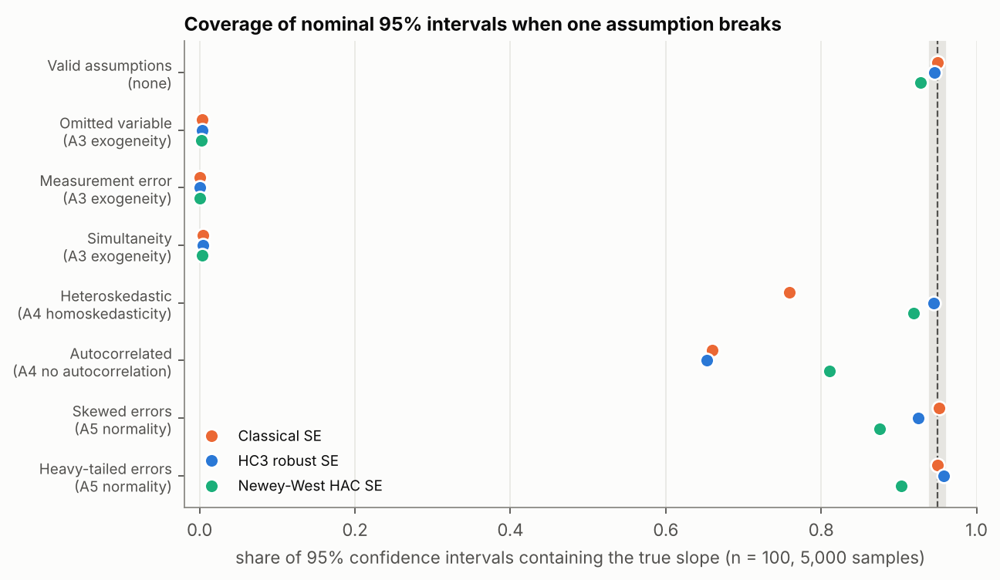
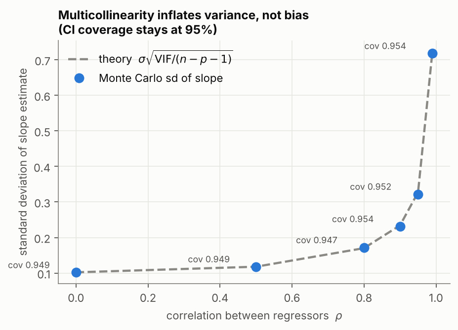
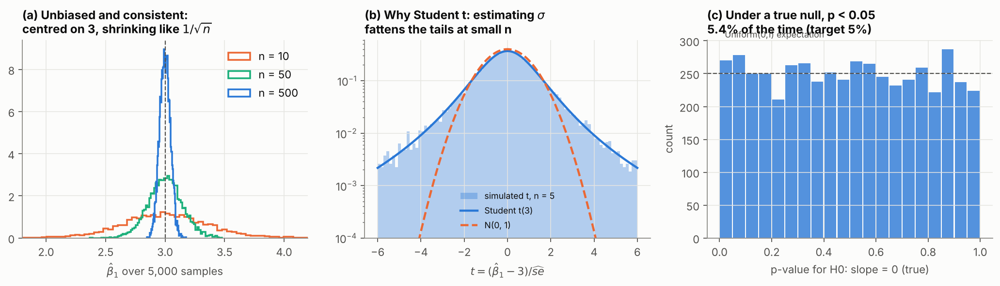
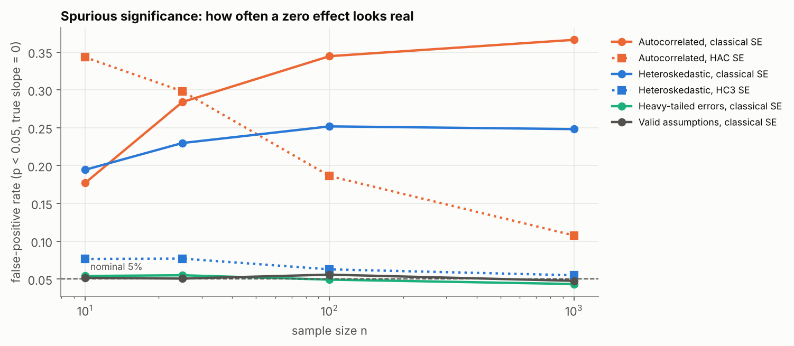
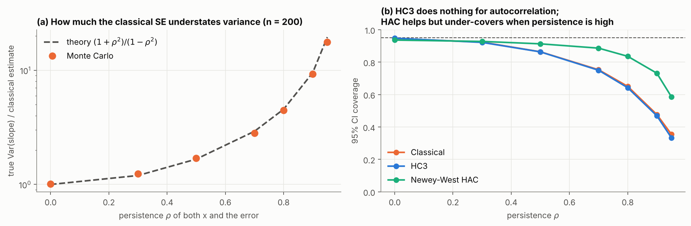
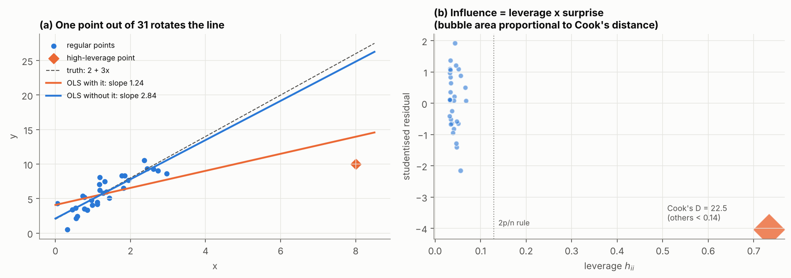

# When Regression Lies

A Monte Carlo study of ordinary least squares: when its guarantees hold, when they break, and what breaks first.

After my linear algebra and regression midterm I could derive $\hat\beta = (X'X)^{-1}X'y$ and list the assumptions behind it, but I had never seen what actually happens when one of them fails. So I set up an experiment where I know the truth. I simulate $Y = 2 + 3X + \varepsilon$ thousands of times, fit OLS each time, and check whether the estimates, standard errors, confidence intervals and p-values do what the theory promises. Then I break one assumption at a time and measure the damage.

Everything is written from scratch in NumPy (QR, normal equations, SVD, hat matrix, classical and robust covariance estimators, t and F tests, leverage, Cook's distance) and tested against `statsmodels` to 10 significant digits.



## Results at a glance

Each row is 5,000 simulated datasets with $n = 100$. "Coverage" is how often a 95% confidence interval contains the true slope of 3. "False positives" is how often a t-test calls the slope significant when the true slope is 0.

| Scenario | Assumption broken | Bias | Classical SE / true sd | Coverage (classical) | Coverage (HC3) | Coverage (HAC) | False positives |
|---|---|---:|---:|---:|---:|---:|---:|
| Valid assumptions | none | +0.000 | 0.99 | 95.0% | 94.6% | 92.8% | 5.6% |
| Omitted variable | A3 exogeneity | +0.998 | 1.00 | 0.3% | 0.4% | 0.3% | 99.8% |
| Measurement error | A3 exogeneity | -0.988 | 0.99 | 0.0% | 0.0% | 0.0% | 5.3% |
| Simultaneity | A3 exogeneity | +0.402 | 0.98 | 0.4% | 0.4% | 0.3% | 99.7% |
| Heteroskedastic | A4 constant variance | -0.001 | 0.59 | 75.9% | 94.4% | 91.9% | 25.2% |
| Autocorrelated | A4 no autocorrelation | +0.002 | 0.48 | 66.0% | 65.3% | 81.1% | 34.5% |
| Skewed errors | A5 normality | -0.001 | 0.94 | 95.1% | 92.5% | 87.5% | 4.3% |
| Heavy-tailed errors | A5 normality | +0.001 | 0.94 | 95.0% | 95.8% | 90.3% | 4.9% |

The table splits into two kinds of failure, and I think that split is the main lesson of the project.

When $X$ is correlated with the error (A3), the estimate itself is wrong. No standard error can rescue it, and collecting more data only makes the wrong answer look more certain. When the errors are heteroskedastic or autocorrelated (A4), the estimate is fine on average but the standard error is wrong, so significance becomes unreliable. That one has a fix. Normality (A5) turns out to matter very little.

## The one identity behind everything

Substituting $y = X\beta + \varepsilon$ into the OLS formula gives

$$\hat\beta = \beta + (X'X)^{-1}X'\varepsilon.$$

Each assumption controls one property of that last term. Exogeneity, $E[\varepsilon \mid X] = 0$, makes its mean zero, so OLS is unbiased. Spherical errors, $\text{Var}(\varepsilon \mid X) = \sigma^2 I$, collapse its variance from the general sandwich $(X'X)^{-1}X'\Omega X(X'X)^{-1}$ to the textbook $\sigma^2(X'X)^{-1}$. Normality makes it exactly Gaussian, which gives exact t and F distributions in small samples.

So the classical standard error is not a fact about the data. It is the sandwich formula evaluated under an assumption. The full derivations are in [`docs/THEORY.md`](docs/THEORY.md).

## 1. The linear algebra

The normal equations $X'(y - X\hat\beta) = 0$ say that the residual is orthogonal to every column of $X$, which makes $\hat y = Hy$ the orthogonal projection of $y$ onto the column space. To draw it, I rotate $\mathbb{R}^3$ with the full QR basis so that the column space lies flat. The rotation preserves angles, so the right angle in the picture is the real one. Numerically, $H = H'$, $H^2 = H$, $\text{tr}(H) = p$ and $X'e = 0$ all hold to about $10^{-16}$.


How you solve the system matters too. Forming $X'X$ squares the condition number, so the error of the normal equations grows like $\epsilon\kappa^2$, while QR and SVD grow like $\epsilon\kappa$. With polynomial regressors at $\kappa \approx 10^8$, QR recovers the coefficients to $10^{-9}$ and the normal equations are off by 25%. This is why NumPy, R and statsmodels all solve least squares with QR or SVD.


Multicollinearity inflates the variance by exactly $1/(1-\rho^2)$, but the estimator stays unbiased and coverage stays at 95% even at $\rho = 0.99$. It is not a violation. The data simply cannot separate two effects that always move together, and the standard errors say so honestly.



## 2. When every assumption holds

With Gaussian $x$, the variance of the slope has a closed form, $1/(n-3)$, because $\sum(x_i - \bar x)^2 \sim \chi^2_{n-1}$ and $E[1/\chi^2_k] = 1/(k-2)$. The simulation matches it at every sample size: at $n = 50$ the theory predicts an sd of 0.1459 and the simulation gives 0.1454.

| n | mean $\hat\beta_1$ | simulated sd | theory sd | coverage, t critical value | coverage, 1.96 |
|---:|---:|---:|---:|---:|---:|
| 5 | 3.006 | 0.723 | 0.707 | 95.7% | 85.9% |
| 10 | 3.002 | 0.372 | 0.378 | 94.6% | 91.1% |
| 50 | 3.002 | 0.145 | 0.146 | 94.9% | 94.4% |
| 1000 | 3.000 | 0.031 | 0.032 | 95.4% | 95.4% |

The last two columns show why the Student t exists. Estimating $\sigma$ adds noise, and with normal critical values a "95%" interval at $n = 5$ covers only 86% of the time. Under a true null the p-values come out uniform, and the F-test of a joint hypothesis rejects 4.9% of the time. Gauss-Markov shows up as well: a competing linear unbiased estimator (Wald's grouping estimator) has sd 0.207, against 0.165 for OLS.



## 3. Breaking the assumptions

### Endogeneity

I built three mechanisms that each correlate $x$ with the error, and each shifts the estimate by exactly what $\text{plim}\,\hat\beta_1 = \beta_1 + \text{Cov}(x,\varepsilon)/\text{Var}(x)$ predicts:

- **Omitted variable.** The true model includes a variable $w$ with $\text{corr}(x, w) = 0.5$, and I leave it out. Predicted bias $+1.000$, simulated $+0.998$. This is the classic problem in estimating the return to education: ability raises both schooling and wages, and it is rarely in the dataset.
- **Measurement error.** I observe $x$ plus noise. Predicted bias $-0.987$, simulated $-0.988$. Any signal measured with noise, from a survey answer to an estimated beta used as a regressor, gets pulled towards zero this way.
- **Simultaneity.** $x$ responds to the shock in $y$. Predicted bias $+0.400$, simulated $+0.401$. Regressing quantity on price runs into this, because prices and quantities are set together.

The bias does not shrink with $n$ but the standard error does, so the t-statistic for the true value diverges. Coverage falls from 74% at $n = 10$ to 0.3% at $n = 100$. The classical SE describes the noise correctly here (ratio 1.00); it just measures precision around the wrong target.


One result surprised me. Measurement error does not create false positives: if the true slope is zero, attenuating it still gives zero. It hides real effects without inventing fake ones. Omitted variables and simultaneity "find" a nonexistent effect 99.8% of the time at $n = 100$.

### Heteroskedasticity and autocorrelation

Here the slope stays unbiased but significance stops meaning what it should. Heteroskedasticity hurts the slope SE only when the noise is largest where $x$ is far from its mean, since those are the points that pin down the slope. In my setup the true variance is $3.1/1.1 \approx 2.8$ times the classical estimate, so the classical SE is about 0.60 of the truth and coverage should be around 76%. The simulation gives 75.9%.

With autocorrelation the false-positive rate actually rises with sample size, from 18% at $n = 10$ to 37% at $n = 1000$. More data does not average the problem away, because the classical formula undercounts the variance by the same factor at every $n$.



### Non-normal errors

With skewed or heavy-tailed errors, coverage is already close to 95% at $n = 10$. Unbiasedness and Gauss-Markov never needed normality, and the central limit theorem takes care of the t-test. The extreme case is Cauchy errors, which have no finite variance. The estimate barely tightens as $n$ grows (its interquartile range only halves between $n = 10$ and $n = 1000$), yet coverage stays near 95% because the t-statistic normalises itself: a huge error inflates both $\hat\beta - \beta$ and $s$. Correct coverage is not the same as useful precision.

## 4. Repairing inference

White's idea is that we cannot estimate each $\sigma_i^2$, but we only need the $p \times p$ matrix $\sum_i \sigma_i^2 x_i x_i'$, and $\sum_i e_i^2 x_i x_i'$ estimates it consistently. The variants differ in how they treat leverage. Residuals at high-leverage points are shrunk, since $\text{Var}(e_i) = \sigma^2(1 - h_{ii})$, so HC0 underestimates exactly where it matters. HC3 divides by $(1 - h_{ii})^2$ to undo this. At $n = 10$ the coverage is 81% classical, 79% HC0, 82% HC1, 86% HC2 and 92% HC3.


The same holds for joint tests. Under heteroskedasticity, a classical F-test of a true null rejects about 20% of the time at every sample size, while a robust Wald test with HC3 rejects 5.3% to 8%. Robust SEs fix inference but not efficiency: weighted least squares with the true weights cuts the slope sd from 0.172 to 0.121, because OLS is no longer the best linear unbiased estimator.

Autocorrelation needs a different tool. When both $x$ and the error follow an AR(1) with coefficient $\rho$, the classical SE understates the variance by $(1+\rho^2)/(1-\rho^2)$, and the simulation follows that curve. HC3 does nothing here, since it only corrects the diagonal of the error covariance. Newey-West adds the autocovariances and helps, but at $\rho = 0.95$ it still covers only 59%.



## 5. Diagnostics

Most violations leave a visible trace in a single dataset: a funnel in the residual spread, a U-shaped running mean when the true relationship is curved, a bent Q-Q plot when the errors are skewed. Endogeneity leaves none. OLS forces $X'e = 0$ by construction, so the residuals cannot show a correlation between $X$ and the true error. You have to rule it out by thinking about where the data came from.


One far-out point among 31 rotates the slope from 2.84 to 1.24. Its residual looks only moderately large, because the line bends towards it (leverage 0.73 against an average of 0.06). Cook's distance, $D_i = \frac{r_i^2}{p}\frac{h_{ii}}{1-h_{ii}}$, catches it immediately: 22.5, while no other point exceeds 0.14.



## Why I care about this for finance

Financial data breaks these assumptions all the time, and in the specific ways simulated here:

- **Volatility clusters.** Returns are heteroskedastic, so classical t-statistics on factor loadings overstate significance.
- **Predictive regressions use slow-moving predictors.** Valuation ratios like the dividend yield, or overlapping multi-month returns, produce the autocorrelated case, where classical t-tests flag a zero effect over a third of the time. This is why Newey-West standard errors became standard in empirical asset pricing.
- **Signals are estimated, not observed.** A noisy signal is the measurement-error case, and its predictive power gets attenuated.
- **Missing risk factors bias alphas.** That is omitted variable bias, and a bigger backtest does not fix it.
- **A few crisis days can drive a coefficient.** Check leverage and Cook's distance before trusting the estimate.

So my defaults are now: report HC3 or HAC standard errors and know which one the data needs; treat a large sample as protection against noise, never against bias; and read a high t-statistic as a statement about the estimator under its assumptions, not about the world.

## Repository

```
src/regression_lies/
    ols.py            OLS from scratch: solvers, hat matrix, classical/HC0-HC3/HAC covariance, tests, diagnostics
    dgp.py            data-generating processes, each breaking exactly one assumption
    montecarlo.py     vectorised engine that fits 5,000 regressions in one call
experiments/          e01 to e05, plus run_all.py
tests/test_ols.py     every estimator checked against statsmodels, plus the projection identities
docs/THEORY.md        derivations behind every result, each linked to the experiment that tests it
docs/STUDY_GUIDE.md   20 questions with answers, from the basics to likely interview follow-ups
results/              all figures and the CSV behind every number in this README
```

```bash
git clone https://github.com/stefsamaha/when-regression-lies.git
cd when-regression-lies
pip install -r requirements.txt
python -m pytest                    # 17 tests against statsmodels
python experiments/run_all.py       # every experiment, about a minute
```

Seeds are fixed, so every number above reproduces exactly. To use the estimator directly:

```python
from regression_lies import OLS
model = OLS(method="qr").fit(X, y)
print(model.summary(cov_type="HC3"))
```

## Limitations and next steps

Each scenario breaks one assumption at a time, while real data usually breaks several at once. The coverage numbers depend on the parameters I chose, all of which are explicit in `dgp.py`. The next things I want to add are instrumental variables (2SLS) as the actual fix for endogeneity, the wild and block bootstrap, clustered standard errors, and data-driven bandwidth choice for HAC.

**References:** White (1980), MacKinnon and White (1985), Newey and West (1987), Long and Ervin (2000), Wooldridge (2010), Golub and Van Loan (2013). Full list in [`docs/THEORY.md`](docs/THEORY.md).
